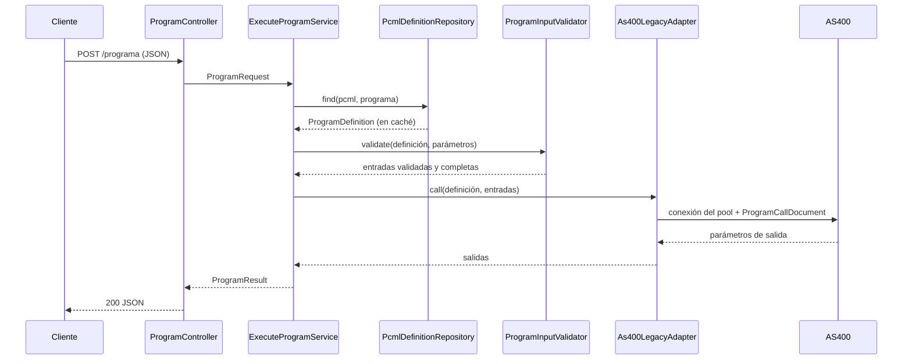

# conector-core

Microservicio que expone programas del **AS400 (IBM i)** como una **API REST**.

Un único endpoint genérico, `POST /programa`, ejecuta cualquier programa CL, RPG o SQLRPGLE del AS400: recibe JSON,
llama al programa con [jt400](https://github.com/IBM/JTOpen) y devuelve sus parámetros de salida en JSON. La forma de
los parámetros de cada programa se describe en un archivo **PCML**, así que **exponer un programa nuevo no requiere
escribir código: basta con agregar su `.pcml`**.

```
Cliente ──JSON──▶ POST /programa ──▶ conector-core ──jt400 + PCML──▶ AS400 (programa)
        ◀──JSON──                ◀──               ◀── parámetros de salida ──
```

| | |
|---|---|
| Stack | Java 21 · Quarkus 3.40 · jt400 21.0 · Maven |
| Arquitectura | Hexagonal (puertos y adaptadores) |
| Guía de instalación paso a paso (AS400 + conector) | [guide-local.md](guide-local.md) |
| Colección de Postman | [postman/conector-core.postman_collection.json](postman/conector-core.postman_collection.json) |

---

## Contenido

- [Inicio rápido](#inicio-rápido)
- [API](#api)
- [Cómo se describe un programa (PCML)](#cómo-se-describe-un-programa-pcml)
- [Programas de ejemplo](#programas-de-ejemplo)
- [Arquitectura](#arquitectura)
- [Conexión con el AS400 y escalabilidad](#conexión-con-el-as400-y-escalabilidad)
- [Configuración](#configuración)
- [Agregar un programa](#agregar-un-programa)
- [Pruebas](#pruebas)
- [Limitaciones](#limitaciones)

---

## Inicio rápido

Requisitos: **JDK 21+** (Maven no hace falta, el proyecto trae `./mvnw`) y una cuenta en el AS400.

```bash
export AS400_PASSWORD='tu-contraseña'   # host y usuario tienen valor por defecto (pub400.com / sdsantish)
./mvnw quarkus:dev                       # http://localhost:8080
```

Comprobar que responde sin tocar el AS400:

```bash
curl -X POST http://localhost:8080/programa \
  -H 'Content-Type: application/json' \
  -d '{ "pcml": "noexiste" }'
# {"error":"No existe el PCML noexiste"}
```

Para crear los programas de ejemplo en el AS400 sigue [guide-local.md](guide-local.md).

---

## API

### `POST /programa`

**Petición**

```json
{
  "pcml": "suma",
  "programa": "suma",
  "parametros": { "num1": 10.5, "num2": 4.25 }
}
```

| Campo | Obligatorio | Descripción |
|---|---|---|
| `pcml` | Sí | Nombre del archivo en `src/main/resources/pcml/`, sin `.pcml`. Solo letras, números y `_`. |
| `programa` | No | Programa dentro del PCML. Solo hace falta si el PCML define más de uno. |
| `parametros` | Según el programa | Parámetros de entrada por nombre. Las estructuras van como objetos y los arreglos como listas. |

**Respuesta `200`**

```json
{
  "pcml": "suma",
  "programa": "suma",
  "resultado": { "result": 14.75000 }
}
```

`resultado` contiene los parámetros de salida del programa (`output` e `inputoutput`), por nombre.

**Reglas de los parámetros**

- Los nombres no distinguen mayúsculas: `pInput`, `PINPUT` y `pinput` son el mismo parámetro.
- `usage="input"`: obligatorio (salvo que el PCML le dé un `init`).
- `usage="inputoutput"`: opcional; si no se envía se rellena con blancos o ceros.
- `usage="output"`: no se envía.
- Un arreglo con menos elementos que su `count` se completa con blancos/ceros; con más, se rechaza.
- Los textos se devuelven sin los espacios de relleno del AS400.

**Errores** (siempre con cuerpo `{ "error": "mensaje" }`)

| Código | Cuándo | Ejemplo |
|---|---|---|
| `400` | La petición no encaja con el PCML | `Falta el parámetro name` · `El parámetro name admite como máximo 20 caracteres` · `Parámetros no definidos en el PCML: [EDAD]` · `No existe el PCML noexiste` |
| `502` | El programa falló en el AS400 | `El programa saludo falló: CPF4131 - ...` |
| `503` | No hay conexión con el AS400 (caído o todas las conexiones ocupadas) | `No se pudo conectar al AS400 pub400.com: ...` |
| `500` | El PCML está mal formado o usa algo no soportado | Ver log del servicio |

---

## Cómo se describe un programa (PCML)

PCML es el formato XML de IBM para describir los parámetros de un programa del AS400. El conector lo usa para saber
qué pedir en el JSON, cómo validarlo y cómo enviarlo.

```xml
<pcml version="4.0">
   <program name="saludo" path="/QSYS.LIB/SDSANTISH1.LIB/SALUDO.PGM">
      <data name="name" type="char" length="20" usage="input"/>
      <data name="msg"  type="char" length="30" usage="output"/>
   </program>
</pcml>
```

- `path`: librería y programa en el AS400.
- Cada `<data>` es un parámetro, **en el mismo orden** que los recibe el programa.
- `<struct>` (o `type="struct"`) describe una estructura → objeto JSON.
- `count` describe un arreglo → lista JSON. Puede ser un número fijo o el nombre de otro parámetro que indica cuántos
  elementos hay (útil para devolver solo los registros encontrados).

| CL | RPG | PCML | JSON |
|---|---|---|---|
| `*CHAR LEN(n)` | `char(n)` | `type="char" length="n"` | texto |
| `*DEC LEN(p s)` | `packed(p:s)` | `type="packed" length="p" precision="s"` | número |
| — | `zoned(p:s)` | `type="zoned" length="p" precision="s"` | número |
| `*INT LEN(4)` | `int(10)` | `type="int" length="4" precision="31"` | entero |
| `*INT LEN(2)` | `int(5)` | `type="int" length="2" precision="15"` | entero |
| — | `int(20)` | `type="int" length="8" precision="63"` | entero |
| `*UINT LEN(4)` | `uns(10)` | `type="int" length="4" precision="32"` | entero |
| — | `float(8)` | `type="float" length="8"` | número |
| — | `dcl-ds` / `likeds` | `<struct>` / `type="struct"` | objeto |
| — | `dim(n)` | `count="n"` | lista |

Para programas RPG, el compilador puede generar el PCML:
`CRTBNDRPG ... PGMINFO(*PCML) INFOSTMF('/tmp/programa.pcml')`.

---

## Programas de ejemplo

Incluidos en el proyecto: fuentes en `src/main/as400/`, PCML en `src/main/resources/pcml/`. Cómo crearlos en el
AS400: [guide-local.md](guide-local.md).

| PCML | Programa | Tipo | Qué hace | Muestra |
|---|---|---|---|---|
| `saludo` | `SALUDO` | CL | Devuelve `HOLA <nombre>` | Texto de entrada y salida |
| `suma` | `SUMA` | CL | Suma dos decimales | Números `packed` |
| `pruebapcml` | `PRUEBAPCML` | RPG | Total de unidades de un carrito | Estructuras, arreglos, PCML generado por el compilador |
| `cliins` | `CLIINS` | SQLRPGLE | Inserta un cliente en la tabla `CLIENTES` | Escritura en base de datos |
| `clicon` | `CLICON` | SQLRPGLE | Consulta clientes por ciudad | Lectura en base de datos, lista de tamaño variable |

Ejemplo con estructuras y arreglos:

```bash
curl -X POST http://localhost:8080/programa \
  -H 'Content-Type: application/json' \
  -d '{
    "pcml": "pruebapcml",
    "parametros": {
      "pInput": {
        "idCliente": 1, "nombre": "CARLOS", "totalItems": 2,
        "listaProd": [ { "idProducto": 10, "cantidad": 3 }, { "idProducto": 20, "cantidad": 4 } ]
      }
    }
  }'
```

```json
{
  "pcml": "pruebapcml",
  "programa": "PRUEBAPCML",
  "resultado": {
    "PINPUT":  { "IDCLIENTE": 1, "NOMBRE": "CARLOS", "TOTALITEMS": 2, "LISTAPROD": [ "...5 elementos..." ] },
    "POUTPUT": { "STATUS": "SUCCESS", "MSG": "Carrito procesado con exito", "TOTALCARRITO": 7 }
  }
}
```

---

## Arquitectura

Arquitectura hexagonal: el núcleo (`core`) define el modelo, las reglas y los contratos (puertos) y no depende de
HTTP ni de jt400. Los adaptadores de `infrastructure` implementan esos contratos, de modo que cambiar la entrada
(p. ej. una cola de mensajes) o la salida (p. ej. XMLSERVICE en vez de jt400) no toca el núcleo.

```
src/main/java/com/as400/
├── config/
│   └── AS400Config.java                    Conexión y pool
├── core/                                   DOMINIO (sin dependencias externas)
│   ├── domain/
│   │   ├── ProgramDefinition.java          Programa y sus parámetros
│   │   ├── ParameterDefinition.java        Parámetro: dato, estructura, arreglo, usage
│   │   ├── ProgramRequest.java             Petición de ejecución
│   │   ├── ProgramResult.java              Salidas del programa
│   │   ├── ProgramInputValidator.java      Reglas: obligatorios, longitudes, rangos, relleno de arreglos
│   │   ├── DefinitionScope.java            Recorrido del árbol de parámetros y referencias de count
│   │   └── exception/                      Errores de negocio
│   └── ports/
│       ├── inbound/ExecuteProgramUseCase.java      Lo que ofrece el servicio
│       └── outbound/
│           ├── ProgramDefinitionPort.java          De dónde salen las definiciones
│           └── As400ProgramPort.java               Cómo se llama a un programa
├── usecases/
│   └── ExecuteProgramService.java          Orquesta: definición → validación → llamada
└── infrastructure/                         ADAPTADORES
    ├── inbound/http/
    │   ├── ProgramController.java          POST /programa
    │   ├── ProgramRequestDto.java / ProgramResponseDto.java / ErrorResponseDto.java
    │   └── HttpExceptionMapper.java        Excepciones de dominio → 400 / 500 / 502 / 503
    └── outbound/
        ├── pcml/
        │   ├── PcmlDefinitionRepository.java   Lee y cachea los .pcml (implementa ProgramDefinitionPort)
        │   └── PcmlResources.java
        └── as400/
            ├── As400LegacyAdapter.java         Llama al programa con jt400 (implementa As400ProgramPort)
            ├── As400Connection.java            Pool de conexiones y límite de concurrencia
            └── mappers/PcmlDocumentMapper.java Capa anticorrupción: dominio ↔ ProgramCallDocument

src/main/resources/pcml/                    Un .pcml por programa
src/main/as400/                             Fuentes CL / RPG / SQL de los programas de ejemplo
postman/                                    Colección de Postman
```

**Flujo de una petición**



La petición se valida **antes** de pedir una conexión: una petición inválida responde `400` sin ocupar el AS400.

---

## Conexión con el AS400 y escalabilidad

- **Pool de conexiones** (`AS400ConnectionPool` de jt400): las conexiones se reutilizan entre llamadas. Se abren
  bajo demanda, se cierran tras `max-inactivity` sin uso y se renuevan al cumplir `max-lifetime`. El pool vive lo que
  vive el servicio: si se vacía, la siguiente petición abre una conexión nueva (tarda un poco más).
- **Límite de concurrencia**: como mucho `max-connections` llamadas simultáneas. Las demás esperan hasta
  `acquire-timeout` y, si no se libera una conexión, reciben `503` en vez de saturar el AS400.
- **Caché**: cada PCML se lee una sola vez; cada llamada trabaja sobre una copia del documento.
- **Sin estado**: se pueden levantar varias instancias detrás de un balanceador. Conexiones totales al AS400 =
  `instancias × max-connections`.

---

## Configuración

En `src/main/resources/application.properties` o con variables de entorno:

| Propiedad | Variable de entorno | Por defecto | Descripción |
|---|---|---|---|
| `as400.host` | `AS400_HOST` | `pub400.com` | Host del AS400 |
| `as400.user` | `AS400_USER` | `sdsantish` | Usuario |
| `as400.password` | `AS400_PASSWORD` | — (obligatoria) | Contraseña. No se guarda en el repositorio. |
| `as400.pool.max-connections` | `AS400_POOL_MAX_CONNECTIONS` | `10` | Conexiones y llamadas simultáneas máximas |
| `as400.pool.acquire-timeout` | `AS400_POOL_ACQUIRE_TIMEOUT` | `30s` | Espera máxima por una conexión libre |
| `as400.pool.max-inactivity` | `AS400_POOL_MAX_INACTIVITY` | `5m` | Cierra conexiones sin uso |
| `as400.pool.max-lifetime` | `AS400_POOL_MAX_LIFETIME` | `1h` | Renueva conexiones antiguas |
| `quarkus.http.port` | `QUARKUS_HTTP_PORT` | `8080` | Puerto del servicio |

**Empaquetar y ejecutar**

```bash
./mvnw package
AS400_PASSWORD='tu-contraseña' java -jar target/quarkus-app/quarkus-run.jar
```

El proyecto incluye Dockerfiles de Quarkus en `src/main/docker/`.

---

## Agregar un programa

1. Crear y compilar el programa en el AS400 (comandos en [guide-local.md](guide-local.md#paso-8--agregar-cualquier-otro-programa)).
2. Crear `src/main/resources/pcml/<nombre>.pcml` describiendo sus parámetros (a mano o generado por el compilador RPG).
3. Reiniciar el servicio (en modo dev, tecla `s`).
4. Llamarlo con `"pcml": "<nombre>"`.

No hay que tocar código Java.

---

## Pruebas

**Automáticas** (no necesitan AS400):

```bash
./mvnw test
```

Cubren la lectura de los PCML, las reglas de validación, la escritura en el documento de jt400 y las respuestas de
error del endpoint.

**Manuales**: importar en Postman
[postman/conector-core.postman_collection.json](postman/conector-core.postman_collection.json). Trae una carpeta por
programa de ejemplo y otra con los casos de error, cada una con aserciones. La variable `baseUrl` apunta a
`http://localhost:8080`. La carpeta *Errores de validación* funciona sin AS400; las demás necesitan los programas
creados.

---

## Limitaciones

- Tipos soportados en las entradas: `char`, `packed`, `zoned`, `int`, `float`.
- Solo programas (`*PGM`), no procedimientos de programas de servicio (`*SRVPGM`).
- Atributos de PCML como `offset` u `outputsize` los resuelve jt400; el conector no los valida.
